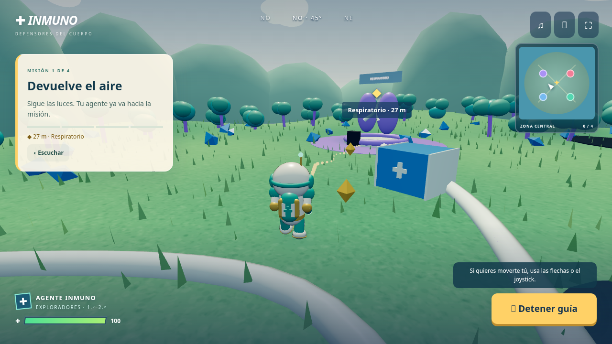

# INMUNO · misiones guiadas en tercera persona · versión 3

La aventura está organizada en cuatro misiones cortas y un núcleo final. **Guíame** sigue un camino de luces, activa la estación y acompaña al personaje con la cámara. **Mantén Proteger** apunta y elige la defensa adecuada. Cada zona termina con una pregunta recuperable y una insignia. Lumi ayuda con escudos y energía. Hay tres niveles para toda primaria.

Incluye un **tráiler de unos 49 segundos, narrado en español y con subtítulos**, que enseña esos mismos pasos con capturas de la partida. Se ofrece antes de empezar y puede repetirse desde Pausa → Cómo jugar. El personaje, los materiales, el terreno, la vegetación, el cielo y la iluminación se han revisado.



[Guía de la versión 3 y sus misiones](docs/MISIONES-GUIADAS.md). [Dirección visual](DESIGN.md).

## Abrir el juego y el tráiler

Descarga `descarga/JUEGO-INMUNO.zip` y **extrae todos sus archivos en una misma carpeta**. Abre **JUGAR-INMUNO.html** con Chrome, Edge o Firefox. Elige el nivel y pulsa Ver tráiler y jugar, o entra directamente al tutorial.

El ZIP contiene el HTML autónomo de acción, el MP4 del tráiler y el modo de cartas anterior. No necesita instalación, cuentas ni conexión. El modo de acción requiere WebGL 2. El vídeo usa un archivo MP4 contiguo; conserva ese archivo junto al HTML. El progreso se guarda por región y se puede exportar/importar desde Pausa. El enlace de entrega es una descarga, no un sitio multijugador.

Los controles manuales son opcionales: flechas o WASD para mover y joystick en móvil. El botón Proteger también admite Espacio/Enter con el foco y la tecla P. No necesitas controlar cámara, cambiar herramienta, saltar ni construir para completar las misiones. Música y efectos se desactivan por separado.

## Modo de cartas anterior

Se conserva en `cartas.html` durante desarrollo o en **MODO-CARTAS.html** dentro de la descarga. Sus reglas y controles son los siguientes:

| Nivel | Grados | Aventura | Duelo |
|---|---|---|---|
| Exploradores | 1.º–2.º | 4 misiones; sistemas ya construidos; un nivel de infección; dos respuestas, pistas y vocabulario corto | 90 cartas: sistemas, virus, bacterias y cuatro defensas |
| Defensores | 3.º–4.º | 9 misiones: construir, curar, vacunar y formar inmunidad | 108 cartas: sistemas, infecciones salvo mutación y todas las defensas |
| Estrategas | 5.º–6.º | 9 misiones; preguntas sobre afinidad y evolución de infecciones | 128 cartas: añade mutación, seis tratamientos y dos eventos globales |

**Aventura:** elige carta → pulsa la isla en el mundo o el mapa → Usar aquí → responde al descubrimiento. Si quedan niveles, usa otra defensa. Los errores ofrecen pistas y permiten repetir. Cada misión da de una a tres estrellas. Al completar las cuatro islas, abre el portal central.

**Duelo:** juega contra uno o varios bots, o entre 2 y 6 participantes en la misma pantalla. Cada persona tiene su cuerpo y mano. Elige un cuerpo a la derecha para verlo. Las cartas seleccionadas señalan destinos posibles; también puedes cambiar de una a tres cartas como tu acción del turno. Los tratamientos abren una lista de destinos válidos. Gana quien logre cuatro sistemas distintos estables, sin pandemia ni aislamiento. El cambio de participante oculta las manos hasta pulsar «Estoy listo». No incluye multijugador por Internet.

Arrastra para girar la cámara, rueda para acercar. El mapa mueve al explorador a cada isla. Teclas 1/2/3 seleccionan carta; Enter la usa. Los botones del mapa, las cartas y las preguntas admiten teclado. El panel **Sonido** controla música, efectos y volumen por separado; la música comienza tras el primer gesto. **Escuchar** utiliza una voz española del navegador, cuando esté disponible. **Sesión** permite exportar/importar JSON, deshacer la última acción humana y cambiar de nivel. El progreso se guarda localmente; abrir una partida nueva pide confirmación.


## Desarrollo

Node 24 y Python 3.12 en el entorno preparado. El juego compilado está incluido: para servirlo no necesitas descargar dependencias.

```bash
cd /workspace/davidmontano/inmuno
npm ci --cache /workspace/.npm-cache
npm run build
npm start
```

El servidor usa el puerto 8090. Comprueba internamente `http://127.0.0.1:8090/`; no es un enlace público. Puede alojarse esta carpeta en cualquier servidor estático HTTPS. La publicación de un sitio web requiere configurar ese alojamiento; el ZIP publicado en GitHub es una descarga.

```bash
npm test
npm run build:download
npm run test:browser
npm run test:media
```

35 pruebas del motor verifican movimiento, salto, herramientas, daño, barreras, reintentos y tres partidas de acción completas; también incluyen 30 partidas completas de 2–6 bots, conservación exacta de las 128 cartas, reglas de defensas, tratamientos y eventos, y las tres aventuras. `npm run test:browser` recorre las cuatro misiones guiadas y el núcleo con los botones Guíame y Proteger, y comprueba preguntas, insignias, guardado y pantalla móvil. Las pruebas de rutas completan los tres niveles sin controlar cámara ni herramienta. `npm run trailer:check` valida la composición del vídeo con HyperFrames. `npm run test:cards` conserva las pruebas de las aventuras por cartas de 4/9/9 misiones. El Chromium del entorno bloquea `file://` por política; la prueba autónoma sirve el HTML exacto mediante una ruta sintética interceptada sin acceso real a red. Abrir el archivo desde el explorador de archivos requiere revisión en el navegador del usuario.

El script de navegador usa Playwright y Chromium. Admite `PLAYWRIGHT_MODULE` y `CHROMIUM_PATH`; en este entorno reutiliza las herramientas preinstaladas. En otra máquina instala Playwright por separado y facilita esas rutas. No es necesario para jugar.

## Estructura y decisiones

- `data.js`: cartas originales, niveles, preguntas y hechos sobre el cuerpo.
- `engine.js`: reglas deterministas, turnos, bot, validación y transacciones de estado.
- `world.js`: geometría 3D, cámara, selección de órganos, microbios, avatar y animaciones.
- `app.js`: selecciona acción o cartas; `cards-app.js` conserva la interfaz anterior.
- `action-engine.js`, `action-world.js`, `action-app.js`: simulación, mundo y controles del videojuego.
- `guidance.js`: rutas A*, seguimiento, apuntado, selección de herramienta y ayuda de energía.
- `trailer/`: composición HyperFrames, narración, música original y capturas reales.
- `media/TRAILER-INMUNO.mp4`: vídeo explicativo para reproducción dentro y fuera del juego.
- `audio.js`: composición instrumental y efectos originales mediante Web Audio, sin archivos externos.
- `assets/origen.json`: procedencia y referencias de las imágenes originales.
- `scripts/build_download.py`: integra los 27 PNG y el motor completo en los dos HTML autónomos y un ZIP.

Las tarjetas grandes de impresión superan el límite de transferencia de 32 MB. Las 23 ilustraciones de cartas y las fichas se extrajeron de la **GUÍA DE JUEGO INMUNO ESPAÑOL.pdf** aportada, que contiene ese mismo material. No se redibujaron las cartas. Los órganos, avatar y microbios del mundo son geometría 3D nueva. No se incluyen las ocho cartas en blanco ni la caja para imprimir.

La adaptación parte de la guía española; las diferencias, erratas resueltas y decisiones digitales están detalladas en [docs/REGLAS.md](docs/REGLAS.md). Se conservó el juego anterior en `../ancestral`.
