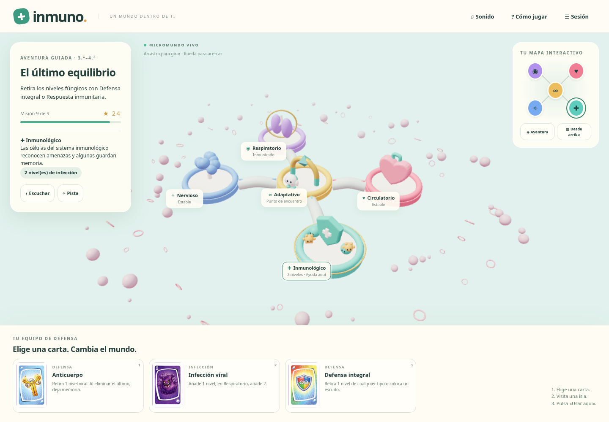

# INMUNO · Un mundo dentro de ti

Adaptación web de INMUNO para toda primaria. Mundo 3D real con Three.js: cinco islas conectadas por vasos, órganos modelados, célula exploradora, microbios y barreras que cambian con las cartas. Incluye las 23 ilustraciones originales recuperadas de la guía española.

## Jugar en tu navegador

Descarga `descarga/JUEGO-INMUNO.zip`, extrae el contenido y abre **JUGAR-INMUNO.html** con Chrome, Edge o Firefox. El archivo contiene todo: escena, cartas, estilos, música y efectos. No requiere conexión ni instalar herramientas. Necesita WebGL 2 para mostrar el mundo; si no está disponible, puedes jugar con el mapa y las cartas.

El enlace público de descarga se encuentra en el mensaje de entrega. En GitHub también puedes entrar al ZIP y pulsar **Download raw file**.

| Nivel | Grados | Aventura | Duelo |
|---|---|---|---|
| Exploradores | 1.º–2.º | 4 misiones; sistemas ya construidos; un nivel de infección; dos respuestas, pistas y vocabulario corto | 90 cartas: sistemas, virus, bacterias y cuatro defensas |
| Defensores | 3.º–4.º | 9 misiones: construir, curar, vacunar y formar inmunidad | 108 cartas: sistemas, infecciones salvo mutación y todas las defensas |
| Estrategas | 5.º–6.º | 9 misiones; preguntas sobre afinidad y evolución de infecciones | 128 cartas: añade mutación, seis tratamientos y dos eventos globales |

**Aventura:** elige carta → pulsa la isla en el mundo o el mapa → Usar aquí → responde al descubrimiento. Si quedan niveles, usa otra defensa. Los errores ofrecen pistas y permiten repetir. Cada misión da de una a tres estrellas. Al completar las cuatro islas, abre el portal central.

**Duelo:** juega contra uno o varios bots, o entre 2 y 6 participantes en la misma pantalla. Cada persona tiene su cuerpo y mano. Elige un cuerpo a la derecha para verlo. Las cartas seleccionadas señalan destinos posibles; también puedes cambiar de una a tres cartas como tu acción del turno. Los tratamientos abren una lista de destinos válidos. Gana quien logre cuatro sistemas distintos estables, sin pandemia ni aislamiento. El cambio de participante oculta las manos hasta pulsar «Estoy listo». No incluye multijugador por Internet.

Arrastra para girar la cámara, rueda para acercar. El mapa mueve al explorador a cada isla. Teclas 1/2/3 seleccionan carta; Enter la usa. Los botones del mapa, las cartas y las preguntas admiten teclado. El panel **Sonido** controla música, efectos y volumen por separado; la música comienza tras el primer gesto. **Escuchar** utiliza una voz española del navegador, cuando esté disponible. **Sesión** permite exportar/importar JSON, deshacer la última acción humana y cambiar de nivel. El progreso se guarda localmente; abrir una partida nueva pide confirmación.



## Desarrollo

Node 24 y Python 3.12 en el entorno preparado. El juego compilado está incluido: para servirlo no necesitas descargar dependencias.

```bash
cd /workspace/davidmontano/inmuno
npm ci --cache /workspace/.npm-cache
npm run build
npm start
```

El servidor usa el puerto 8090. Comprueba internamente `http://127.0.0.1:8090/`; no es un enlace público. Puede alojarse esta carpeta en cualquier servidor estático HTTPS. La publicación de un sitio web requiere configurar ese alojamiento; el ZIP publicado en GitHub es una descarga.

```bash
npm test
npm run build:download
npm run test:browser
```

19 pruebas del motor incluyen 30 partidas completas de 2–6 bots, conservación exacta de las 128 cartas, reglas de defensas, tratamientos y eventos, y las tres aventuras. Las pruebas de navegador completan las campañas de 4/9/9 misiones, verifican respuesta del bot, descarte, controles de sonido, adaptación móvil, ausencia de errores JavaScript y el HTML autónomo con toda la red real bloqueada. El Chromium del entorno bloquea `file://` por política; por eso la prueba autónoma sirve el HTML exacto mediante una ruta sintética interceptada sin acceso a red. El gesto de abrir el archivo desde el explorador de archivos requiere revisión en el navegador del usuario.

El script de navegador usa Playwright y Chromium. Admite `PLAYWRIGHT_MODULE` y `CHROMIUM_PATH`; en este entorno reutiliza las herramientas preinstaladas. En otra máquina instala Playwright por separado y facilita esas rutas. No es necesario para jugar.

## Estructura y decisiones

- `data.js`: cartas originales, niveles, preguntas y hechos sobre el cuerpo.
- `engine.js`: reglas deterministas, turnos, bot, validación y transacciones de estado.
- `world.js`: geometría 3D, cámara, selección de órganos, microbios, avatar y animaciones.
- `app.js`: interfaz, preguntas, selección de destinos, privacidad local, audio y guardado.
- `audio.js`: composición instrumental y efectos originales mediante Web Audio, sin archivos externos.
- `assets/origen.json`: procedencia y referencias de las imágenes originales.
- `scripts/build_download.py`: integra los 27 PNG y el motor completo en un único HTML y un ZIP.

Las tarjetas grandes de impresión superan el límite de transferencia de 32 MB. Las 23 ilustraciones de cartas y las fichas se extrajeron de la **GUÍA DE JUEGO INMUNO ESPAÑOL.pdf** aportada, que contiene ese mismo material. No se redibujaron las cartas. Los órganos, avatar y microbios del mundo son geometría 3D nueva. No se incluyen las ocho cartas en blanco ni la caja para imprimir.

La adaptación parte de la guía española; las diferencias, erratas resueltas y decisiones digitales están detalladas en [docs/REGLAS.md](docs/REGLAS.md). Se conservó el juego anterior en `../ancestral`.
