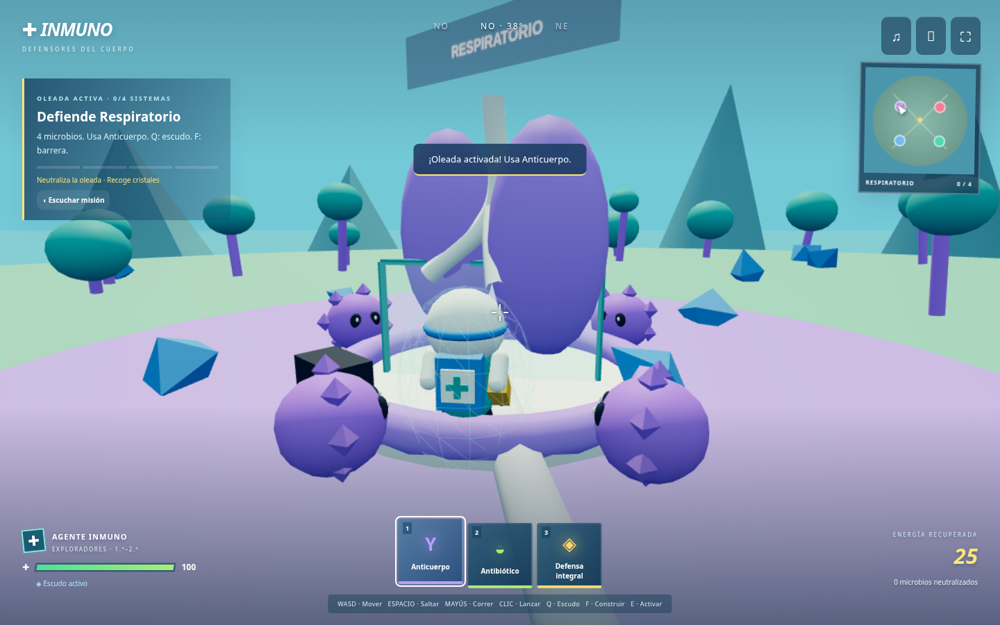

# INMUNO · Defensores del cuerpo · versión 2

El juego principal es ahora una aventura de acción en tercera persona: controlas un agente 3D, corres, saltas, apuntas, lanzas defensas, construyes barreras y esquivas microbios. Hay cuatro regiones, un mapa, oleadas y un enfrentamiento final. Incluye tres dificultades para toda primaria, música y efectos desactivables y las ilustraciones originales en el códex.



**Controles:** WASD, Mayús para correr, Espacio para saltar, botón derecho + arrastrar para cámara, clic para lanzar, 1/2/3 para herramienta, Q para escudo, F para barrera, E para estación o portal. En móvil hay joystick y botones táctiles. [Guía del modo de acción](docs/ACCION.md).

## Jugar en tu navegador

Descarga `descarga/JUEGO-INMUNO.zip`, extrae el contenido y abre **JUGAR-INMUNO.html** con Chrome, Edge o Firefox. Ese archivo abre directamente el videojuego de acción y contiene escena, interfaz, ilustraciones, música y efectos. El ZIP también incluye MODO-CARTAS.html para conservar el juego anterior. No requiere conexión ni instalar herramientas. El modo de acción necesita WebGL 2. Si no está disponible, abre MODO-CARTAS.html para jugar al modo anterior con su mapa alternativo.

El enlace público de descarga se encuentra en el mensaje de entrega. En GitHub también puedes entrar al ZIP y pulsar **Download raw file**.

## Modo de cartas anterior

Se conserva en `cartas.html` durante desarrollo o en **MODO-CARTAS.html** dentro de la descarga. Sus reglas y controles son los siguientes:

| Nivel | Grados | Aventura | Duelo |
|---|---|---|---|
| Exploradores | 1.º–2.º | 4 misiones; sistemas ya construidos; un nivel de infección; dos respuestas, pistas y vocabulario corto | 90 cartas: sistemas, virus, bacterias y cuatro defensas |
| Defensores | 3.º–4.º | 9 misiones: construir, curar, vacunar y formar inmunidad | 108 cartas: sistemas, infecciones salvo mutación y todas las defensas |
| Estrategas | 5.º–6.º | 9 misiones; preguntas sobre afinidad y evolución de infecciones | 128 cartas: añade mutación, seis tratamientos y dos eventos globales |

**Aventura:** elige carta → pulsa la isla en el mundo o el mapa → Usar aquí → responde al descubrimiento. Si quedan niveles, usa otra defensa. Los errores ofrecen pistas y permiten repetir. Cada misión da de una a tres estrellas. Al completar las cuatro islas, abre el portal central.

**Duelo:** juega contra uno o varios bots, o entre 2 y 6 participantes en la misma pantalla. Cada persona tiene su cuerpo y mano. Elige un cuerpo a la derecha para verlo. Las cartas seleccionadas señalan destinos posibles; también puedes cambiar de una a tres cartas como tu acción del turno. Los tratamientos abren una lista de destinos válidos. Gana quien logre cuatro sistemas distintos estables, sin pandemia ni aislamiento. El cambio de participante oculta las manos hasta pulsar «Estoy listo». No incluye multijugador por Internet.

Arrastra para girar la cámara, rueda para acercar. El mapa mueve al explorador a cada isla. Teclas 1/2/3 seleccionan carta; Enter la usa. Los botones del mapa, las cartas y las preguntas admiten teclado. El panel **Sonido** controla música, efectos y volumen por separado; la música comienza tras el primer gesto. **Escuchar** utiliza una voz española del navegador, cuando esté disponible. **Sesión** permite exportar/importar JSON, deshacer la última acción humana y cambiar de nivel. El progreso se guarda localmente; abrir una partida nueva pide confirmación.


## Desarrollo

Node 24 y Python 3.12 en el entorno preparado. El juego compilado está incluido: para servirlo no necesitas descargar dependencias.

```bash
cd /workspace/davidmontano/inmuno
npm ci --cache /workspace/.npm-cache
npm run build
npm start
```

El servidor usa el puerto 8090. Comprueba internamente `http://127.0.0.1:8090/`; no es un enlace público. Puede alojarse esta carpeta en cualquier servidor estático HTTPS. La publicación de un sitio web requiere configurar ese alojamiento; el ZIP publicado en GitHub es una descarga.

```bash
npm test
npm run build:download
npm run test:browser
```

30 pruebas del motor verifican movimiento, salto, herramientas, daño, barreras, reintentos y tres partidas de acción completas; también incluyen 30 partidas completas de 2–6 bots, conservación exacta de las 128 cartas, reglas de defensas, tratamientos y eventos, y las tres aventuras. `npm run test:browser` comprueba el nuevo modo de acción con controles reales: desplazamiento, primera oleada, salto, escudo, barrera, pregunta, guardado, sonido, joystick móvil y HTML sin red. `npm run test:cards` conserva las pruebas de las aventuras por cartas de 4/9/9 misiones. El Chromium del entorno bloquea `file://` por política; la prueba autónoma sirve el HTML exacto mediante una ruta sintética interceptada sin acceso real a red. Abrir el archivo desde el explorador de archivos requiere revisión en el navegador del usuario.

El script de navegador usa Playwright y Chromium. Admite `PLAYWRIGHT_MODULE` y `CHROMIUM_PATH`; en este entorno reutiliza las herramientas preinstaladas. En otra máquina instala Playwright por separado y facilita esas rutas. No es necesario para jugar.

## Estructura y decisiones

- `data.js`: cartas originales, niveles, preguntas y hechos sobre el cuerpo.
- `engine.js`: reglas deterministas, turnos, bot, validación y transacciones de estado.
- `world.js`: geometría 3D, cámara, selección de órganos, microbios, avatar y animaciones.
- `app.js`: selecciona acción o cartas; `cards-app.js` conserva la interfaz anterior.
- `action-engine.js`, `action-world.js`, `action-app.js`: simulación, mundo y controles del nuevo videojuego.
- `audio.js`: composición instrumental y efectos originales mediante Web Audio, sin archivos externos.
- `assets/origen.json`: procedencia y referencias de las imágenes originales.
- `scripts/build_download.py`: integra los 27 PNG y el motor completo en los dos HTML autónomos y un ZIP.

Las tarjetas grandes de impresión superan el límite de transferencia de 32 MB. Las 23 ilustraciones de cartas y las fichas se extrajeron de la **GUÍA DE JUEGO INMUNO ESPAÑOL.pdf** aportada, que contiene ese mismo material. No se redibujaron las cartas. Los órganos, avatar y microbios del mundo son geometría 3D nueva. No se incluyen las ocho cartas en blanco ni la caja para imprimir.

La adaptación parte de la guía española; las diferencias, erratas resueltas y decisiones digitales están detalladas en [docs/REGLAS.md](docs/REGLAS.md). Se conservó el juego anterior en `../ancestral`.
