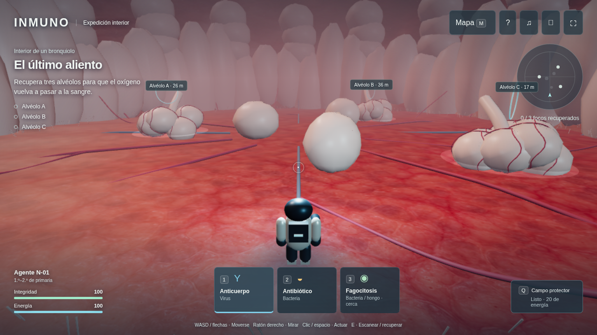

# INMUNO · Expedición interior · versión 4

Videojuego individual en tercera persona dentro de tejidos del cuerpo humano. El jugador mueve y orienta al nanobot, escanea focos, elige una defensa, apunta y recupera tejido. No hay autopiloto, selección automática de herramienta o enemigo ni curación automática al esperar.



Cuatro misiones: alvéolos e intercambio gaseoso; bacterias y endotelio de un vaso sanguíneo; conexiones neuronales que se recuperan en orden; y esporas de hongos en un ganglio linfático. Cada región tiene tres focos. El mapa corporal abre la siguiente región al completar la anterior. Los tres niveles cubren 1.º–2.º, 3.º–4.º y 5.º–6.º de primaria con distinta resistencia, número de amenazas, pistas y tiempo de reacción.

## Abrir

Descarga `descarga/JUEGO-INMUNO.zip`, extrae todos los archivos y abre **JUGAR-INMUNO.html** con Chrome, Edge o Firefox. No necesita cuenta, instalación ni conexión. Requiere WebGL 2; la fluidez depende de la aceleración gráfica del dispositivo. También se puede alojar esta carpeta en un servidor estático. El ZIP de GitHub es una descarga, no una dirección de una web alojada ni multijugador.

## Controles

| Acción | Orden |
|---|---|
| Moverse | WASD / flechas; Mayúsculas para avanzar más rápido |
| Orientar cámara | Ratón derecho y arrastrar; Z / C con teclado |
| Elegir herramienta | 1, 2, 3 o botones inferiores |
| Actuar apuntando | Clic izquierdo / Espacio |
| Escanear un foco cercano | E |
| Recuperar tejido despejado | Mantener E cerca del foco |
| Campo protector | Q; consume energía y tiene recarga |
| Mapa / pausa | M / Esc |

En móvil hay joystick, zona derecha para mirar y botones de acción y herramientas. El tutorial explica las tres fases; permite escuchar las instrucciones cuando el navegador dispone de voz. Música, efectos y volumen se controlan por separado. El progreso se guarda entre regiones y se puede exportar/importar desde Pausa. Cambiar de región avisa si se perderá avance de la misión actual.

## Qué cambió

La isla exterior y sus órganos decorativos se sustituyen por cámaras interiores con tejido celular, capilares, membranas, células, eritrocitos en circulación y ramificaciones neuronales. Se añadió una textura de epitelio generada para este proyecto, materiales físicos, detalle de superficie, iluminación interior, niebla y cámara que evita atravesar estructuras. Las figuras son geometría original procedural, no modelos anatómicos escaneados. Es una representación didáctica a escala ampliada, no una reconstrucción médica fotorrealista ni un videojuego de presupuesto AAA.

La energía del instrumental se recarga; la integridad se recupera con recursos y objetivos. Un antibiótico no elimina virus. Fagocitosis tiene alcance corto y mayor coste. El nanobot, los proyectiles y los encuentros son metáforas de juego: las defensas reales son más complejas y los medicamentos solo se usan por indicación profesional. Se adaptó el contenido de la guía española; el juego original por turnos sigue en **MODO-CARTAS.html** / `cartas.html`, con sus reglas en [docs/REGLAS.md](docs/REGLAS.md).

## Desarrollo y pruebas

```sh
npm ci --cache /workspace/.npm-cache
npm run build
npm start
```

Puerto local 8090. `http://127.0.0.1:8090` sirve para comprobar el entorno; no es un enlace público.

```sh
npm test
npm run test:browser
npm run build:download
npm run test:media
npm run test:cards
```

Las pruebas de `anatomy.test.js` verifican ausencia de automatismos, movimiento, cobertura, selección manual, defensas incompatibles, alcance, coste de escudo, derrota, reparación interrumpida, orden neuronal, esporas, guardado y campañas completas en los tres niveles. Las pruebas de navegador recorren la interfaz y la campaña, comprueban teclado y móvil; utilizan un control de poses habilitado solo con `?qa=1` para evitar largos desplazamientos durante la prueba. No sustituye una sesión de evaluación con alumnado. El HTML autónomo exacto se comprueba en un origen sintético interceptado, bloqueando acceso real a red; el Chromium administrado bloquea navegación directa `file://`.

## Código y procedencia

- `anatomy-engine.js`: simulación y reglas separadas del renderizado.
- `anatomy-world.js`: geometría, materiales, iluminación, cámara y representación.
- `anatomy-app.js`: controles, objetivos, mapa, tutorial, sonido y progreso.
- `cards-app.js`, `engine.js`, `world.js`: modo original por cartas.
- `action-*.js`, `guidance.js`: implementación anterior conservada como referencia, sin cargar en el nuevo videojuego.
- `audio.js`: música y efectos originales mediante Web Audio.
- `trailer/`: explicación en vídeo con capturas reales y voz española.
- [docs/skills](docs/skills/README.md): habilidades descargadas, revisiones, instrucciones y licencias de Frontend Design y Three.js Skills.
- `assets/origen.json`: referencias de las 23 cartas y fichas extraídas de la guía aportada. Se conservan sus ilustraciones originales.
- `assets/tissue/origen.json`: procedencia de la textura nueva.
- `scripts/build_download.py`: integra el código, los 27 PNG y la textura JPEG en los HTML autónomos y genera el ZIP.

La publicación anterior de Calabozos y Dragones se conserva en `../ancestral`.
